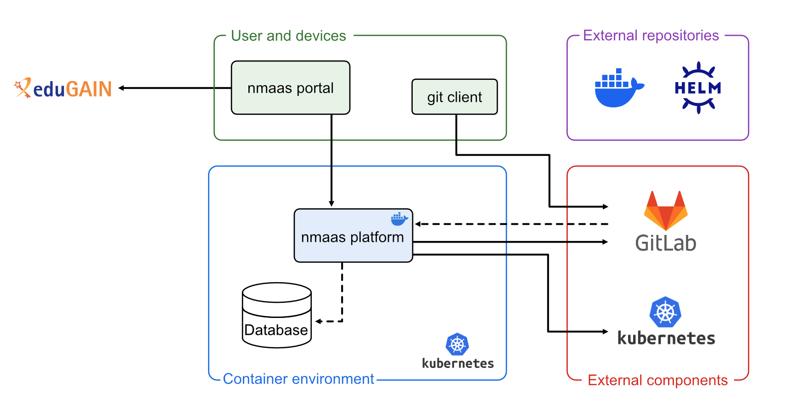

# Architecture

nmaas architecture is made up of two primary and one supporting components. The primary components, namely the nmaas Platform and the nmaas Portal, have been developed within the GÉANT project and are released under the Apache License 2.0 license.

{ width="350" }

More details about the role that each of these components plays are provided in the subsections below.

## nmaas Platform

nmaas Platform is the central nmaas backend component, exposing a REST API consumed by the nmaas Portal. It stores the application catalogue, information about users and their roles, as well as implements the orchestrated application instance deployment process. It interacts with a GitLab instance to store the application configuration templates as well as with the underlying Kubernetes cluster using a built-in Helm client and API client library.

**External dependencies: PostgreSQL database, self-hosted GitLab instance**

## nmaas Portal

nmaas Portal represents the front-end application of nmaas that consumes the REST API offered by nmaas Platform. nmaas Portal is an Angular-based application run in the user's browser.

## nmaas Postfix

nmaas Postfix is an in-cluster mail server used by any deployed applications to send emails to external destinations. It does not require any authentication before sending emails, and it can either be configured as a standalone mail server, or it can use a smart host, routing all outgoing emails through some other email server (e.g., Gmail).

!!! warning "nmaas Postfix without a Smart Host"

    If nmaas Postfix is not configured to use an external mail service for sending the emails, than most likely all outgoing emails will be marked as spam, and users will face delivery problems when sending alerts from their deployed applications.
