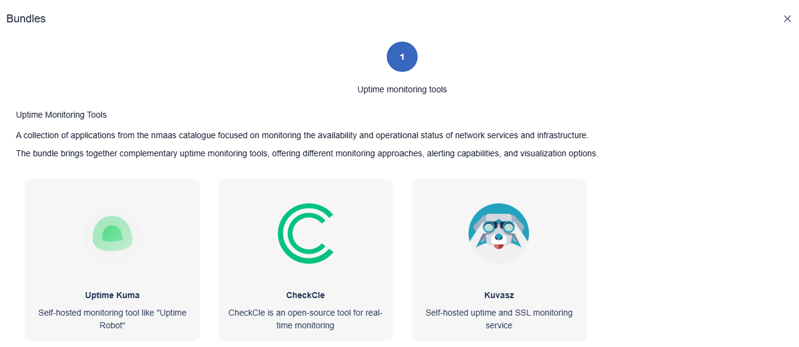

# 1.11.0

Date: 2026/11/13

## General

[nmaas 1.11.0](https://gitlab.software.geant.org/nmaas/nmaas-platform/-/releases/v1.11.0) is a milestone release including central variable storage, application bundles, extended permissions for group managers and several improvements to application deployment, webhook and remote cluster handling.

## New Features

### Central variable storage

System and domain level variables can now be defined centrally and used as values in application deployment specification parameters, with domain level values taking precedence.

### Application bundles

Added support for application bundles, which can be composed of multiple applications with a title and description.

<figure markdown>
  
  <figcaption>Application bundle view</figcaption>
</figure>

### Update of release values without redeploying

Application instance configuration can now be updated by executing a Helm upgrade command with new values, without the need to redeploy the application.

### Extended permissions for group managers

Group managers can now add, edit and delete individual domains, manage resource limits on group level, update domain technical details and annotations, and access domain users and details.

### Admin dashboard with detailed domain group activity logs

Added a new dashboard displaying detailed logs of activities within a domain group.

## Enhancements

### Templates for webhook content

Webhook request content can now be generated from templates, with webhook history storing the actual body sent.

### External kubeconfig support

The Platform can now run using an external kubeconfig file for central cluster management, and edited kubeconfig files of remote clusters are persisted to the file system.

### Improved remote cluster management

Added endpoints for retrieval of complete remote cluster information and filtering of application instances deployed on a given remote cluster.

### More advanced configuration passed as Helm install values

Nested JSON objects can now be passed as additional parameters from the deployment wizard to the Helm install command, with all arguments persisted.

### Application state history improvements

History entries now include information about the user that initiated each state change.

### REST API security improvement

Requests with an invalid authorization header now return a 401 response instead of a 302 redirect.

### Platform and dependency upgrades

Upgraded the platform to Java 25, Kubernetes client to version 8 and other supporting dependencies.

## Bug Fixes

### Fixed display of the UUID token

Corrected the value returned for the user access UUID token.
